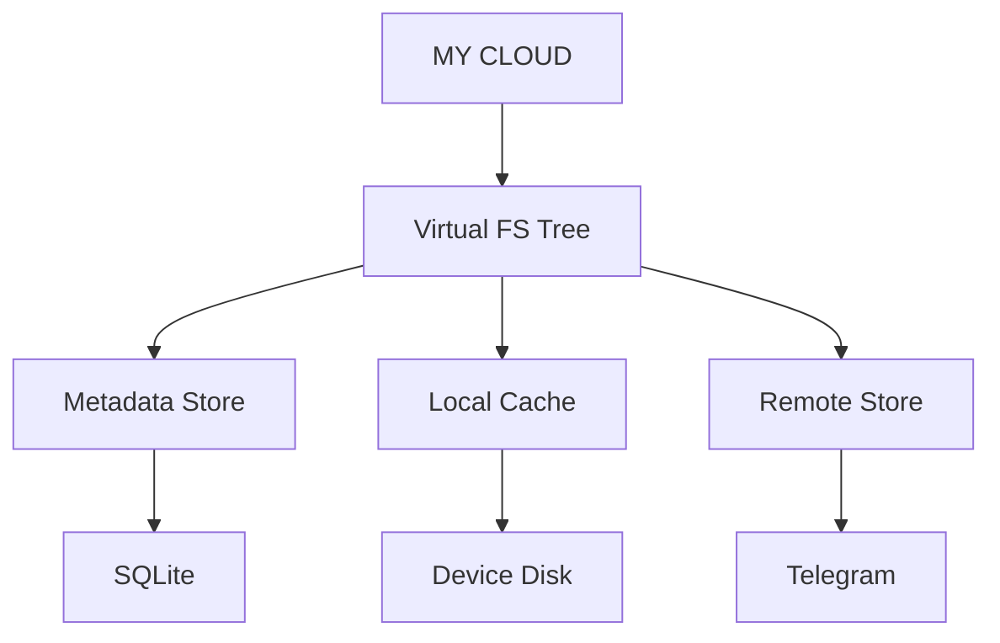

# MyCloud Architecture and Roadmap

## 1. Virtual Filesystem Model
The core of MyCloud is the **Virtual Filesystem Tree**. The metadata store acts as the source of truth, independent of where the physical files reside.



### Data Models

**Node** (Virtual entity)
```rust
struct Node {
    id: Uuid,
    parent_id: Option<Uuid>,
    name: String,
    node_type: NodeType, // File, Directory
    size: u64,
    hash: String,
    version: u64,
    created_at: DateTime,
    modified_at: DateTime,
}
```

**StorageObject** (Remote representation)
```rust
struct StorageObject {
    node_id: Uuid,
    provider: ProviderType, // e.g., Telegram
    remote_id: String, // e.g., Telegram message_id
    size: u64,
    hash: String,
}
```

**LocalObject** (Local device representation)
```rust
struct LocalObject {
    node_id: Uuid,
    device_id: String,
    local_path: String,
    state: LocalState, // Cached, Syncing, etc.
}
```

## 2. Separation of Concerns
The virtual identity of a file is completely separate from its physical location.
A single file (e.g., `Resume.pdf`) exists as:
- **Virtual identity:** `node_id = 123`
- **Telegram:** `message_id = 92831`
- **Laptop:** `/MyCloud/Documents/Resume.pdf`
- **Phone:** `cached = false` (Metadata known, but not downloaded)

## 3. Hydration and On-Demand Files
A file can be either:
- **REMOTE ONLY:** Known to the device via metadata sync, but taking up 0 bytes locally.
- **HYDRATED:** Downloaded and available in the local cache.

When a remote-only file is accessed, the local cache manager downloads it from Telegram, hydrates it on the disk, and makes it available. The local cache manager can also purge the file later to free space while keeping the virtual file and remote copy intact.

## 4. Lifecycle Example (File Creation)
When a file is created on the laptop, the workflow is as follows:
1. Create file locally
2. Virtual FS creates node
3. Local cache stores file
4. Calculate hash
5. Sync engine detects new object
6. Upload to Telegram
7. Receive Telegram object ID
8. Update metadata
9. Other devices receive sync event
10. Other devices update metadata ("file exists", size, date) but *don't download it yet*.

## 5. Development Roadmap

### Phase 1: Virtual Filesystem Simulator (Current)
Build a local virtual filesystem simulator before touching Telegram.
Operations to support:
- `mkdir`
- `create`
- `read`
- `write`
- `rename`
- `move`
- `delete`
- `stat`
- `list`

### Phase 2: Local Cache & Data Model
Implement SQLite for metadata storage.
Define the Data Model (`Node`, `StorageObject`, `LocalObject`).

### Phase 3: Sync Engine State Machine
Implement the state machine for syncing.
Detecting changes, keeping track of versions.

### Phase 4: Storage Abstraction & Telegram Provider
Implement the generic storage abstraction.
Implement the Telegram backend to upload/download chunks/files.

### Phase 5: End-to-End Testing & Desktop/Mobile Architecture
Integrate all pieces.
Handle conflict resolution and versioning.
Refine MVP.
